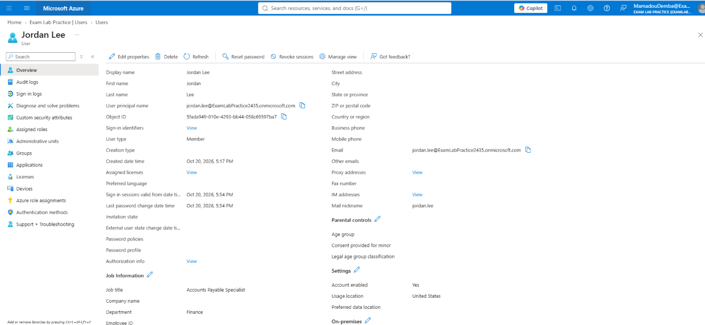
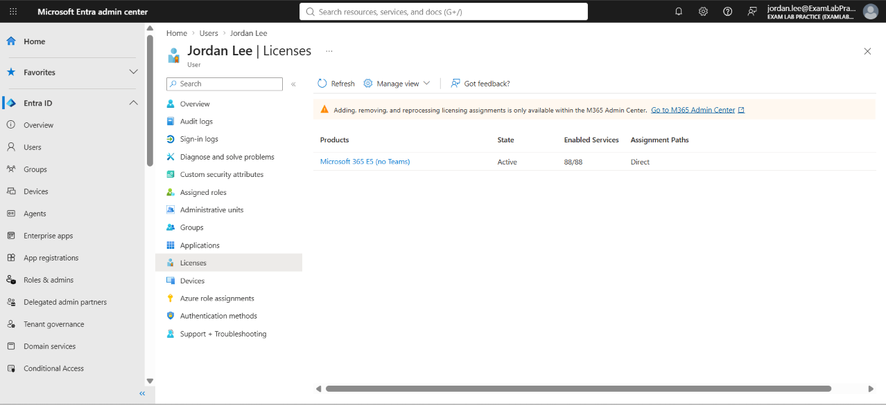
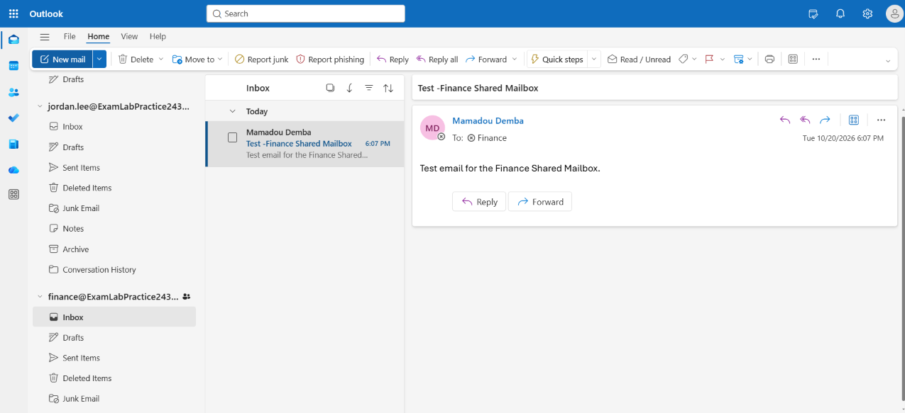

# T01 – New hire onboarding

**Short description:** New Hire Account and finance@ mail access for Jordan Lee

**Description:** Robert Kim (Finance Manager) requested a user account for new hire Jordan Lee, starting Monday as an Accounts Payable Specialist in Finance. Jordan needs standard Finance access and access to the finance@ shared mailbox.

| Field | Value |
|---|---|
| Incident | INC0010001 |
| Caller | Robert Kim (Finance Manager) |
| Category | Inquiry / Help |
| Impact / Urgency | 3 – Low / 2 – Medium |
| Priority | 4 – Low |
| SLA | P4 Resolution – 5 business days (met) |
| Assigned group | Service Desk - Tier 1 |

## Request
> "Jordan Lee starts Monday in Finance as an Accounts Payable Specialist. They need an account and access to the finance@ mailbox."

## Triage
P4 – Low. Standard onboarding request with a start date several days out; no one is blocked from working.

## Steps taken
1. Created the user in Microsoft Entra ID with Department (Finance) and Job title (Accounts Payable Specialist), and a temporary password requiring change at next sign-in.
2. Added the user to `SG-Finance` and `SG-AllStaff`.
3. Confirmed the Microsoft 365 E5 (no Teams) license was active on the account.
4. In the Exchange admin center, granted Jordan **Read and manage (Full Access)** and **Send as** on the finance@ shared mailbox.

## Verification
Signed in as Jordan in a private browser session, changed the temporary password, registered Microsoft Authenticator, and opened the finance@ shared mailbox in Outlook on the web.

## Resolution notes
Account created and licensed. Finance group and finance@ shared mailbox access granted. User verified sign-in, MFA registration, and mailbox access.

## Screenshots

