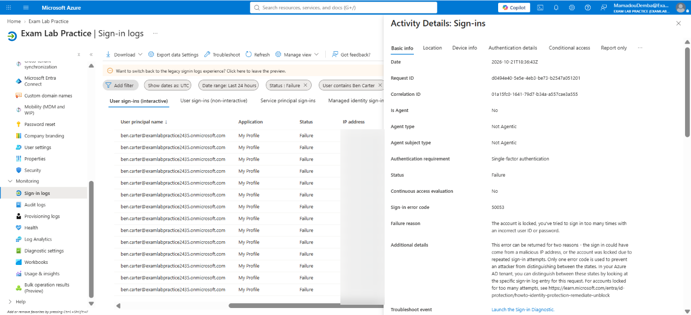
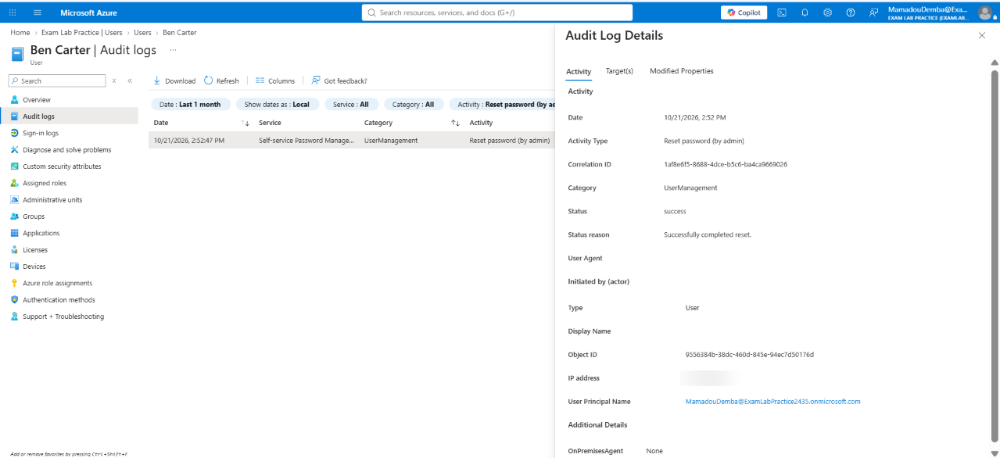

# T02 – Account locked out after forgotten password

**Short description:** Caller forgot password and entered it incorrectly a few times and got locked out of their account.

**Description:** Ben Carter (Service Desk Analyst) forgot his password and, after several sign-in attempts, received a message that his account was locked. He cannot access email or other Microsoft 365 apps.

| Field | Value |
|---|---|
| Incident | INC0010002 |
| Caller | Ben Carter (Service Desk Analyst) |
| Category | Password Reset |
| Impact / Urgency | 3 – Low / 1 – High |
| Priority | 3 – Moderate |
| SLA | P3 Resolution – 3 business days (met) |
| Assigned group | Service Desk - Tier 1 |

## Request
> "I forgot my password, tried a few times, and now it says my account is locked."

## Triage
P3 – Moderate. A single user is blocked from working, with no wider impact.

## Steps taken
1. Reviewed Entra ID sign-in logs for the user. Found a series of **50126** failures (invalid username or password) followed by **50053** (account locked by smart lockout).
2. Confirmed the lockout was caused by repeated wrong passwords, not a Conditional Access block or a disabled account.
3. Verified the caller's identity before making changes (simulated callback to the number on file).
4. Reset the password in Entra ID with "require change at next sign-in" enabled. Provided the temporary password through a separate channel.
5. Advised the user to wait for the lockout period to expire before signing in.

## Verification
User signed in with the temporary password after the lockout expired and set a new password.

## Resolution notes
Cause: smart lockout triggered after repeated failed sign-ins (threshold 5, duration 60 seconds). Fix: identity verified, password reset with forced change at next sign-in. Recommendation: enable self-service password reset so users can reset forgotten passwords without a ticket.

## Screenshots

