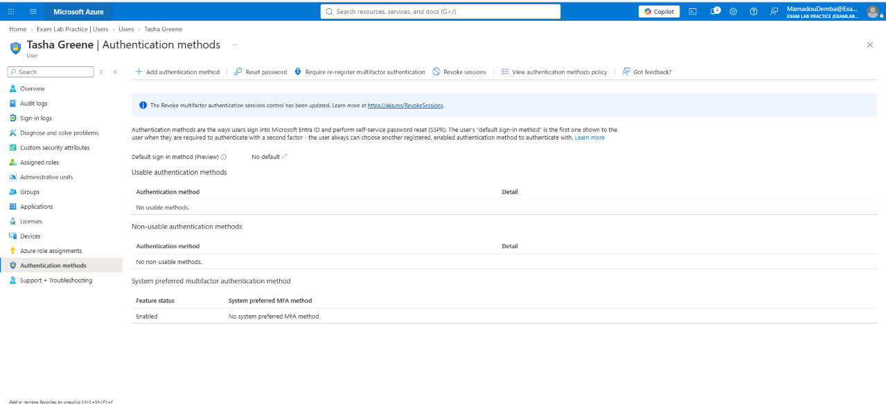
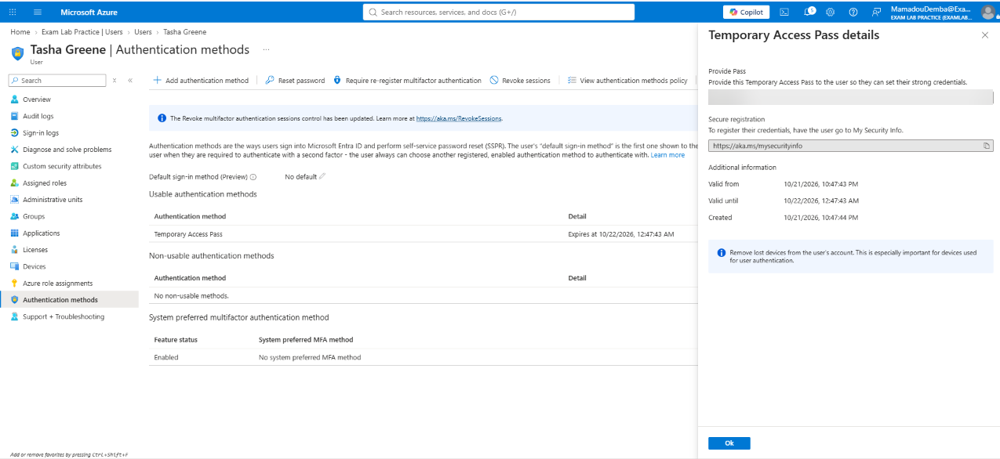

# T03 – New phone, unable to approve MFA sign-ins

**Short description:** Unable to complete MFA – new phone

**Description:** Tasha Greene (Senior Accountant) replaced her phone and can no longer approve Microsoft Authenticator sign-in requests. She is unable to sign in to Microsoft 365.

| Field | Value |
|---|---|
| Incident | INC0010003 |
| Caller | Tasha Greene (Senior Accountant) |
| Category | Inquiry / Help |
| Impact / Urgency | 3 – Low / 1 – High |
| Priority | 3 – Moderate |
| SLA | P3 Resolution – 3 business days (met) |
| Assigned group | Service Desk - Tier 1 |

## Request
> "I got a new phone and can't approve sign-ins anymore."

## Triage
P3 – Moderate. A single user is blocked from signing in, with no wider impact.

## Steps taken
1. Verified the caller's identity before making changes (simulated callback to the number on file).
2. In Entra ID → Users → Tasha Greene → Authentication methods, removed the Microsoft Authenticator registration tied to the old phone.
3. Revoked the user's active sessions, in case the old device was lost rather than replaced.
4. Issued a one-time **Temporary Access Pass** so the user could sign in once and register the new phone.

## Verification
User signed in with the Temporary Access Pass and registered Microsoft Authenticator on the new phone. Subsequent sign-in completed with an MFA approval on the new device.

## Resolution notes
Cause: MFA method was registered to a phone the user no longer has. Fix: old method removed, sessions revoked, Temporary Access Pass issued for re-registration. MFA remained enforced throughout; it was never disabled for the user.

## Screenshots

