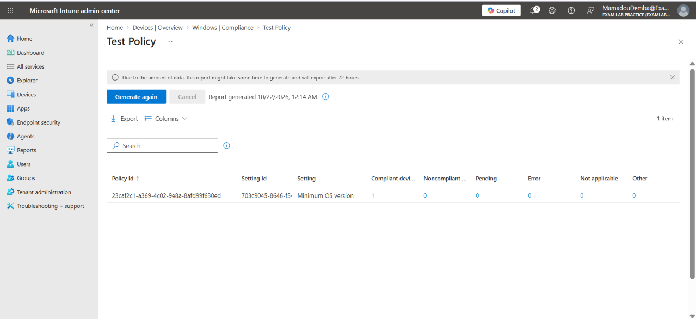
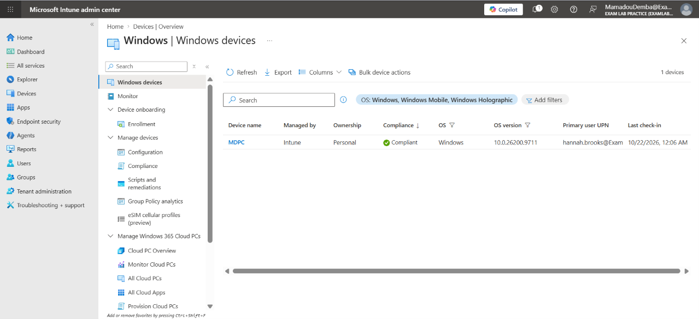

# T04 – Laptop flagged as noncompliant

**Short description:** Laptop flagged noncompliant in Intune

**Description:** Hannah Brooks (Accounts Receivable Specialist) received a notice that her laptop is not compliant with company policy. Noncompliant devices may lose access to company resources.

| Field | Value |
|---|---|
| Incident | INC0010004 |
| Caller | Hannah Brooks (Accounts Receivable Specialist) |
| Category | Hardware |
| Impact / Urgency | 3 – Low / 1 – High |
| Priority | 3 – Moderate |
| SLA | P3 Resolution – 3 business days (met) |
| Assigned group | Service Desk - Tier 1 |

## Request
> "I got an email saying my laptop isn't compliant."

## Triage
P3 – Moderate. A single device is affected; the user can still work but risks losing access to company data.

## Steps taken
1. In the Intune admin center, confirmed the device (MDPC, primary user hannah.brooks) was **Not compliant** under the compliance policy `Test Policy`.
2. Opened the policy's per-setting status: **Minimum OS version** showed 1 noncompliant device. The device was running Windows 10.0.26200.9711, below the policy's required minimum.
3. Identified the cause as an outdated OS build rather than a security setting.
4. Lab fix: set the policy minimum to the device's current build. Production fix: the user installs the pending Windows update.
5. Synced the device from Settings → Accounts → Access work or school → Info → Sync.

## Verification
After sync, the device reported **Compliant** in Intune.

## Resolution notes
Cause: device OS build was below the compliance policy's minimum version. Fix: in production, install the pending Windows update and sync the device; in the lab, the policy minimum was aligned to the current build. Verified Compliant status in Intune.

## Screenshots

