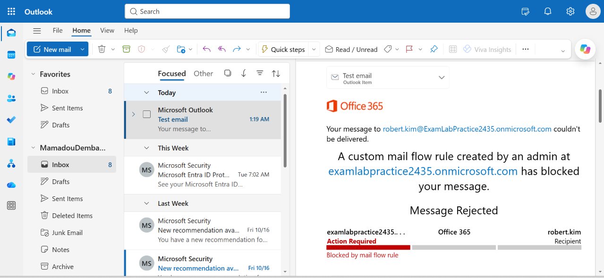
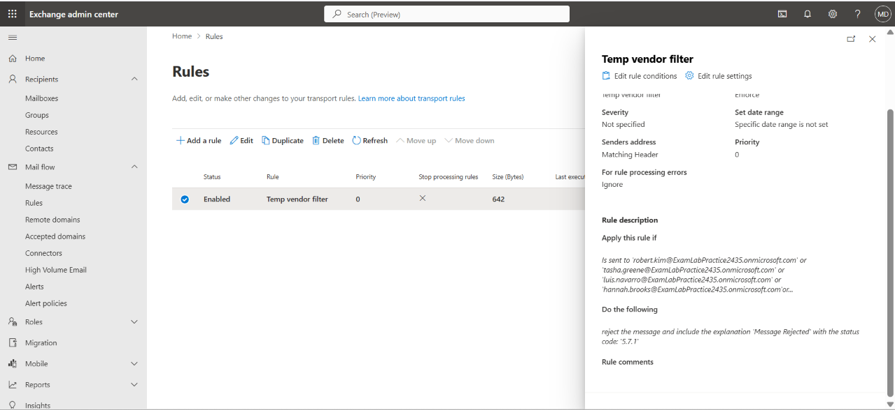
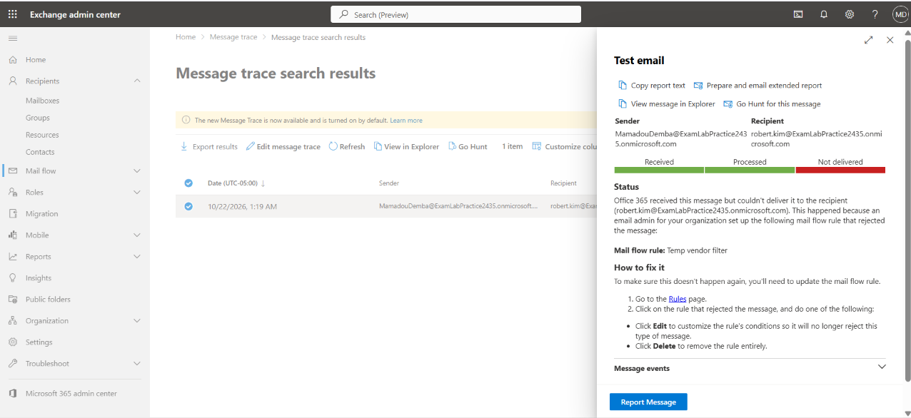
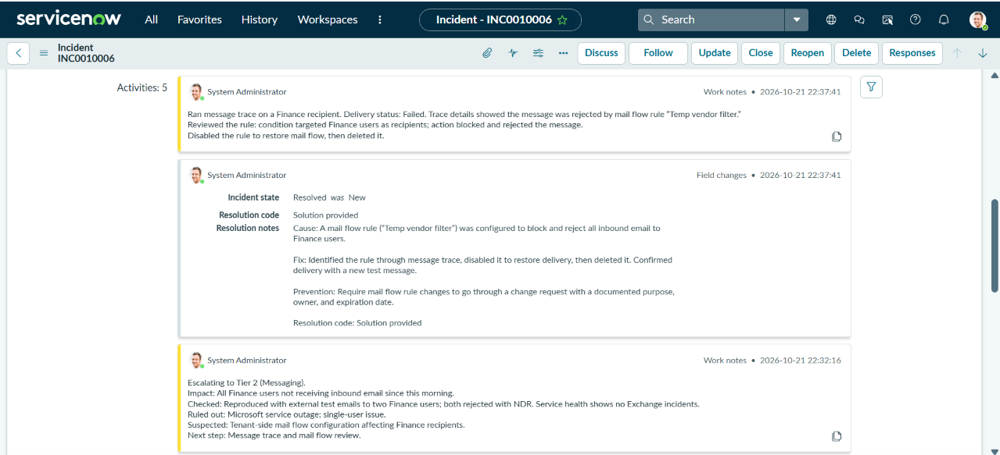
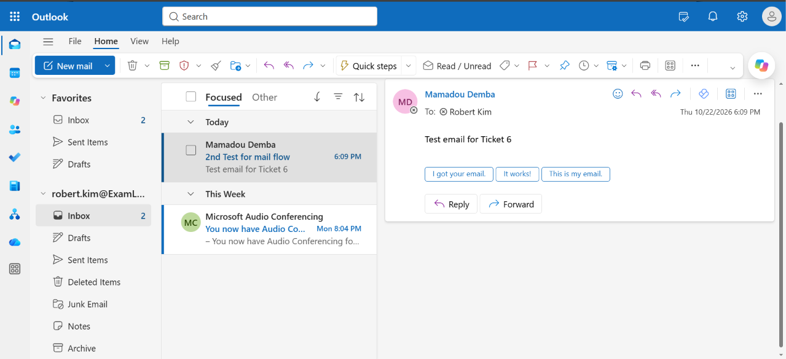

# T06 – Finance email outage and escalation

**Short description:** Finance department not receiving inbound emails

**Description:** Robert Kim (Finance Manager) reported that no one in the Finance department has received email since this morning. Senders are receiving bounce-back messages.

| Field | Value |
|---|---|
| Incident | INC0010006 |
| Caller | Robert Kim (Finance Manager) |
| Category | Software |
| Impact / Urgency | 1 – High / 1 – High |
| Priority | 1 – Critical |
| SLA | P1 Resolution – 4 hours, 24x7 (met) |
| Assigned group | Service Desk - Tier 1 → Service Desk - Tier 2 |

## Request
> "Nobody in Finance has received an email since this morning."

## Triage (Tier 1)
P1 – Critical. Full department impact.

- **Scope:** sent test emails to two Finance users. Both were rejected with a non-delivery report (NDR). A non-Finance user received email normally, so the issue was isolated to Finance recipients.
- **Service health:** Microsoft 365 admin center → Health → Service health showed no active Exchange Online incidents or advisories.
- **Conclusion:** no Microsoft-side outage; cause unknown after standard checks.

## Escalation
Escalated to Service Desk - Tier 2 per SOP (P1, department-wide impact, cause unknown). Handoff work note:

> Escalating to Tier 2 (Messaging).
> Impact: All Finance users not receiving inbound email since this morning.
> Checked: Reproduced with external test emails to two Finance users; both rejected with NDR. Service health shows no Exchange incidents.
> Ruled out: Microsoft service outage; single-user issue.
> Suspected: Tenant-side mail flow configuration affecting Finance recipients.
> Next step: Message trace and mail flow review.

No bridge call was opened: Tier 2 identified the cause within 30 minutes of escalation, per SOP.

## Diagnosis (Tier 2)
Ran a message trace on a Finance recipient for the external test emails. Status: **Failed**. Event details showed the message was rejected by the mail flow (transport) rule **Temp vendor filter**, which blocked and rejected all inbound email to Finance users.

## Steps taken
1. Disabled the `Temp vendor filter` rule to restore delivery.
2. Deleted the rule.
3. Sent a new external test email to a Finance user and confirmed delivery.

## Verification
New test email (sent after the rule was deleted) arrived in Robert Kim's inbox.

## Resolution notes
Cause: a mail flow rule ("Temp vendor filter") was configured to block and reject all inbound email to Finance users.
Fix: identified the rule through message trace, disabled it to restore delivery, then deleted it. Confirmed delivery with a new test message.
Prevention: require mail flow rule changes to go through a change request with a documented purpose, owner, and expiration date.

## Screenshots

